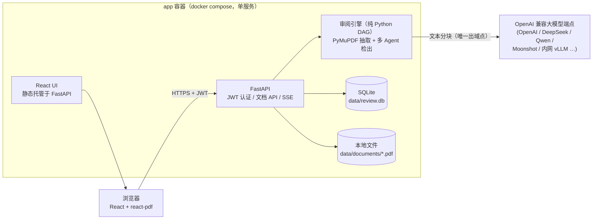

# 架构说明（本地部署版）

## 总体形态

单容器应用：React UI（静态托管）、FastAPI、审阅引擎同进程运行；状态落在挂载卷 `./data/`；唯一外部依赖是 OpenAI 兼容的大模型端点。



> **数据出域边界**：PDF 原件、issues、账号、日志全部留在本地；审阅时抽取出的文本分块会发往 LLM 端点。涉敏文档须数据不出内网时，将 `LLM_BASE_URL` 指向内网 vLLM/SGLang 部署的大参数开源模型，应用侧零改动。

## 组件对照（Azure → 本地）

| Azure 服务 | 现方案 | 说明 |
|---|---|---|
| Blob Storage（浏览器直连） | 文档 API + 本地文件系统 | 上传/列表/下载/删除走 `/api/v1/documents`，JWT 保护 |
| Cosmos DB | SQLite（WAL） | `data/review.db`；客户端接口签名与原实现一致，便于回溯 |
| Document Intelligence | PyMuPDF | 构造 DI 同形的 paragraphs/pages/words 结构（全局字符 offset、pt→英寸），包围盒算法原样复用 |
| Azure OpenAI / AML 端点 | OpenAI 兼容客户端 | `LLM_BASE_URL`/`LLM_API_KEY`/`LLM_MODEL` 三项切换厂商 |
| PromptFlow DAG | 纯 Python 流水线 | `flows/ai_doc_review/pipeline.py`；提示词模板原样保留 |
| Entra ID + MSAL | 本地账号 + JWT | PBKDF2 口令哈希 + PyJWT (HS256)；`AUTH_DISABLED=true` 可免登录 |
| Application Insights | 本地日志 | console + `data/logs/app.log`，不记录 prompt 正文与密钥 |
| Terraform / App Service | Dockerfile + Compose | `task up` 一键启动 |

## 审阅流水线（`flows/ai_doc_review/`）

```
PDF ──► text.py（PyMuPDF 抽取 + 可选 OCR）
        ├─ paragraphs（= PDF block，起始 offset 与词边界对齐）
        ├─ pages[].words[]（词级 bbox，pt÷72 转英寸）
        └─ get_text_chunks() 按 PARAGRAPHS_PER_CHUNK 切块
     ──► pipeline.py
        ├─ 每 chunk：2 维度 × LLM_SHOTS 个 shot 一次性 fan-out（5-shot 检出）
        ├─ 两个维度的 consolidator 并发执行
        ├─ 按 (type, source_sentence) 去重，分配 comment_id
        ├─ consolidator.jinja2 整合（评分 + KEEP/REMOVE 判定）
        ├─ 过滤 REMOVE，add_bounding_box() 回填坐标
        └─ 按 chunk 产出 FlowOutputChunk → SSE
```

- 并发预算：`LLMClient` 内的信号量把在途请求封顶在 `LLM_MAX_WORKERS`（所有维度、所有在跑分块共用）；分块侧 `CHUNK_MAX_WORKERS` 做有界预取，SSE 仍按文档顺序推送。
- 单 shot 或 consolidator 失败只降级当前 chunk，不中断整次审阅。
- 429/5xx/超时指数退避重试与 JSON 校验重试分开计数；记录 token usage 便于控成本。
- 优先 `response_format=json_schema` 严格结构化输出；端点不支持时自动降级 `json_object` 并将 schema 注入提示词。

## API 契约

- `POST /api/v1/auth/login` / `GET /api/v1/auth/me` / `GET /api/v1/auth/config` / `POST /api/v1/auth/logout`
- `POST /api/v1/documents`（multipart 上传）、`GET /api/v1/documents`、`GET /api/v1/documents/{name}/file`、`DELETE /api/v1/documents/{name}`
- `POST /api/v1/review/{doc_id}/issues` — SSE，事件类型 `issues` / `complete` / `error`
- `PATCH /api/v1/review/issues/{id}/status`、`/suggestion`、`/dismissal-feedback`
- `GET /api/health` — LLM 三项配置齐全返回 `ok`，否则 `degraded`

Issue 数据模型见 `common/models.py`（与 Azure 时期完全一致）。

## 目录结构

```
app/api/        FastAPI：routers（auth/documents/issues）、security、database、services
app/ui/         React + Fluent UI + react-pdf（构建产物输出 app/api/www）
common/         共享数据模型与日志
flows/ai_doc_review/  审阅引擎：text/ocr/llm/pipeline/engine/bounding_box + prompts/
eval/           指标评估（读取本地 SQLite）
legacy/         已退役的 Azure 资产（只读历史）
```

## 安全设计

- JWT 存于浏览器 sessionStorage（关闭标签页即失效），不出现在 URL。
- CORS 显式白名单；异常响应脱敏，不回显内部信息。
- 上传校验 `%PDF` 魔数与大小上限；文件名白名单防路径穿越。
- 数据库过滤列走白名单 + `json_extract`，防注入。
- 日志只记 token 用量与错误码，不记 prompt 正文与密钥。

历史架构（Azure 时期）的实现细节 wiki 保留在 [docs/wiki/](./wiki/README.md)，仅供历史参考。
