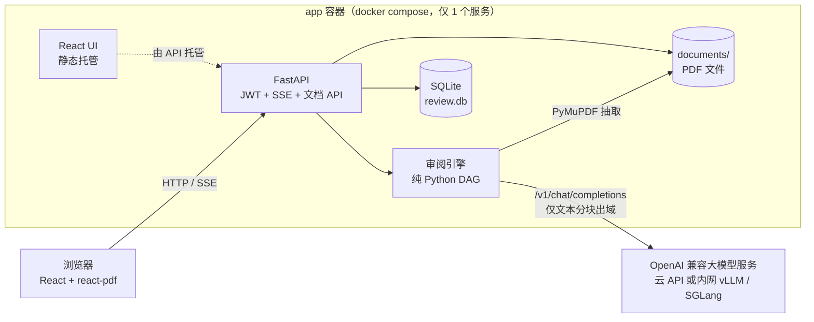

# AI Document Review 本地化改造方案（设计稿 · v2）

> **状态：方案已确认，代码改造尚未启动。** 本文是后续实施的唯一依据，文中所有「重写 / 新增 / 删除 / 迁移」均为**计划动作**，不代表当前仓库状态。
>
> 当前工作区与改造前一致：`app/api/config/config.py`、`app/api/database/config.py`、`app/api/database/db_client.py` 曾在中途被改写，已全部还原；中途新建的 `app/api/security/__init__.py` 已删除。除本文外，本阶段未新增或修改任何代码文件。
>
> 编制日期：2026-11-13 ｜ 基准 commit：`c91254a`
>
> **v2 修订（2026-11-13）**：按用户要求，LLM 改为**通过 OpenAI 兼容协议接入大模型**，不再在单机运行本地小模型。由此连带修订了目标边界、组件对照、调用策略（结构化输出 / 限流 / 计费）、配置默认值、验证边界与风险登记，并新增 §3.2 数据出域与合规章节。

---

## 0. 决策记录

| 决策项 | 结论 | 备注 |
|---|---|---|
| 最终目标 | 完整代码改造，本地可跑通全流程 | 本次用户要求**先只出方案文档**，代码改造待另行启动 |
| 本地栈 | 轻量单机栈：SQLite + 本地文件 + 内置账号 JWT + PyMuPDF + OpenAI SDK | 不引入 PostgreSQL / MinIO / Keycloak，**不在应用容器内运行模型** |
| **LLM 选型（v2）** | **OpenAI 兼容协议的大模型服务**；可为云 API，或内网 GPU 上用 vLLM / SGLang 部署的大参数开源模型 | **明确排除单机 7B 级本地小模型**；只约定协议，不绑定厂商 |
| 编排 | 移除 PromptFlow，纯 Python 实现 DAG | 保留提示词与 Pydantic 模型契约 |
| 遗留 Azure 资产 | **统一移入 `legacy/` 目录** | 见第 6 章迁移映射；执行时需同步修复文档内相对链接 |
| 附加范围 | **替换 + 顺带修复已知安全问题** | 见 §4.7；OCR 保持默认关闭 |
| 本阶段交付 | 仅本方案文档一份 | 不改代码、不移动目录、不装依赖 |

> **范围澄清**：「可本地部署」指应用、UI、PDF 原件、审阅结果与账号数据全部留在本地；LLM 推理通过网络调用 OpenAI 兼容端点。因此本方案**不是完全离线方案**，PDF 抽取出的文本会出域，详见 §3.2。若要求数据不出内网，走 §3.2 的路径 B。

---

## 1. 背景、目标与边界

### 1.1 现状

本项目是 Azure-Samples 的 AI Document Review 加速器：用户上传 PDF，Document Intelligence 抽取文本，PromptFlow 编排的多智能体（Azure OpenAI gpt-4o）识别问题，结果经 AML 在线端点以 SSE 流式推到 React UI，人工接受/驳回并沉淀反馈到 Cosmos DB。整条链路依赖 Entra ID 身份、Application Insights 日志，基础设施由 Terraform 部署到 App Service。

### 1.2 目标

- 单机 `docker compose up` 跑通「上传 PDF → 流式审阅 → 高亮定位 → 接受/驳回/反馈」全流程，无需 Azure 账号、托管身份或托管数据库。
- 所有业务数据落在 `./data/`：`review.db`（SQLite）+ `documents/`（PDF），可直接备份、拷贝、本地管理。
- **LLM 能力通过 OpenAI 兼容协议接入大模型**：一个端点地址 + 一个 API Key + 一个模型名即可切换服务商，配置层面不绑定具体厂商，也不要求本地 GPU。
- 用大模型替代原 gpt-4o 的推理角色，保持 5-shot 多智能体审阅的结构化输出质量，避免小模型在长提示词与严格 JSON 约束下的不稳定表现。

### 1.3 不变式（改造的硬约束）

1. **API 契约不变**：`GET /api/v1/review/{doc_id}/issues` 仍返回 `text/event-stream`，事件类型保持 `issues / complete / error`；三个 PATCH 端点（accept / dismiss / feedback）路径与请求体不变。
2. **数据模型不变**：`common/models.py` 的 `Issue`、`Location`、`FlowOutputChunk`、`IssueStatusEnum` 等字段保持原样，前端 `types/issue.ts` 不动。
3. **提示词资产不变**：`flows/ai_doc_review/prompts/{grammar,definitive_language}/` 下 6 个 jinja2 文件原样保留，审阅规则不重写。
4. **前端组件不动**：`IssueCard.tsx`、`annotations.ts`、`Review.tsx` 的 SSE 事件处理与标注逻辑尽量保持，只改数据获取入口。
5. **模型调用协议不变**：仍是 `/v1/chat/completions` 风格的请求，仅把 `AzureOpenAIConnection` 换成通用 OpenAI SDK 客户端。

### 1.4 非目标

- 不实现多租户、RBAC、SSO / OIDC 对接、水平扩容、服务网格。
- 不重建 Azure 的网络安全边界、托管身份、私有链接等企业级能力。
- **不在单机内运行小参数模型**，不在 compose 中编排本地推理服务；模型推理能力由部署方提供的 OpenAI 兼容端点负责。
- 不承诺完全离线运行，也不承诺与特定厂商模型同等检出质量；提示词与模型需按所选服务回归调优。
- 本阶段不做代码改造、不做目录迁移、不做依赖安装。

---

## 2. 现状 Azure 耦合清单

| # | Azure 组件 | 主要耦合位置 | 耦合方式 | 影响面 |
|---|---|---|---|---|
| 1 | Blob Storage | `app/ui/src/main.tsx`、`services/storage.ts`、`pages/files/Files.tsx`、`pages/review/Review.tsx` | 浏览器用 `BlobServiceClient` + MSAL 令牌**直连**存储，绕过 API | 前端 5 个文件、上传/下载/列表 |
| 2 | Cosmos DB | `app/api/database/{config,db_client}.py`、`issues_repository.py`、`config/config.py` | `CosmosClient(..., DefaultAzureCredential())`，同步 SDK 跑在 async 路由里 | 后端数据层、eval 报表 |
| 3 | AML 在线端点 | `app/api/services/aml_client.py`、`dependencies.py` | `MLClient.online_endpoints.get_keys()` + `https://{endpoint}.{region}.inference.ml.azure.com/score` 的 SSE 转发 | 审阅触发链路 |
| 4 | PromptFlow | `flows/ai_doc_review/flows.py`、`process.py`、`process_streaming.py`、`flow.dag.yaml`、`flow.meta.yaml`、`agent_template/**` | `@tool` 装饰器、`load_flow` / `FlowContext`、`typed_llm` 包工具 | 整个流水线目录 |
| 5 | Document Intelligence | `flows/ai_doc_review/text.py`、`bounding_box.py` | `DocumentAnalysisClient` + `prebuilt-document`；`AnalyzeResult` 类型渗入包围盒算法 | 文本抽取与 PDF 高亮 |
| 6 | Azure OpenAI | `flows/ai_doc_review/flows.py`、`agent_template/flow.dag.yaml` | `AzureOpenAIConnection(auth_mode="meid_token")`；`deployment_name: gpt-4o` | LLM 调用 |
| 7 | Entra ID / MSAL | `app/api/security/auth.py`、`main.py`（Swagger OAuth2）、`app/ui/src/authConfig.ts`、`App.tsx`、`services/api.ts` | `fastapi-azure-auth` 单租户 Bearer；前端 MSAL Redirect + localStorage 令牌缓存 | 全栈鉴权 |
| 8 | Application Insights | `app/api/middleware/logging.py`、`requirements.txt` | `AzureLogHandler` + instrumentation key | 日志导出 |
| 9 | 部署链 | `infra/*.tf`、`Taskfile.yml`、`.task/*.yml`、`.github/workflows/main.yml`、`.devcontainer/devcontainer.json` | Terraform(azurerm/azapi)、`az` CLI、`pfazure` | 基础设施与 CI |
| 10 | ML 部署资产 | `flows/ai_doc_review/{deployment,model}.yaml`、`Dockerfile`（`azureml` 基础镜像）、`flow.meta.yaml` 的 `azuremlschemas` | Azure ML 在线部署描述 | 流水线打包 |

---

## 3. 目标架构与组件对照



### 3.1 组件对照与许可证

| Azure 组件 | 本地开源替代 | 许可证 | 选择理由 |
|---|---|---|---|
| Blob Storage | 本地 `documents/` 目录 + FastAPI 上传/下载 | — | 单机零运维；消除浏览器直连与 CORS 复杂度 |
| Cosmos DB | SQLite（WAL，`payload` JSON 列） | Public domain | 单文件、无服务、保留文档式存取语义 |
| AML 在线端点 | 进程内 Python 生成器 | — | 去掉网络跳转与 180s 超时限制 |
| PromptFlow | 纯 Python + jinja2 + openai SDK | MIT / BSD-3 / Apache-2.0 | 依赖最轻、可单测、无 Python 3.13+ 兼容风险 |
| Document Intelligence | PyMuPDF (`fitz`) + 可选 Tesseract OCR | **AGPL-3.0** / Apache-2.0 | 原生提供词级 bbox 与坐标，可对齐 DI 数据结构 |
| Azure OpenAI | **OpenAI 兼容大模型端点**（云 API 或内网 vLLM / SGLang 部署的大参数开源模型） | 客户端 Apache-2.0；服务端按厂商条款 / 模型 License | 协议中立、厂商可换；用大模型保持长提示词下的结构化输出质量；不再依赖 Azure 专属连接与 Entra 令牌 |
| Entra ID + MSAL | PBKDF2 本地账号 + PyJWT (HS256) | MIT | 无外部 IdP；保留 `oid` 语义 |
| Application Insights | Python 标准 `logging` + 本地文件 | — | 去掉云导出；日志留在容器内 |
| Terraform + App Service | Dockerfile + Docker Compose | Apache-2.0 | 一键启动、可离线构建 |

> **合规提示**：PyMuPDF 采用 AGPL-3.0，若本项目未来闭源商用需向 Artifex 购买商业许可，或改用 `pdfplumber`(MIT) / `pypdf`(BSD) 并自行实现词级 bbox 组装。走云 API 时受服务商条款与数据留存策略约束；走内网自建时须确认所用开源模型权重的 License。

### 3.2 模型接入形态与数据出域（v2 新增）

**唯一数据出域点**：审阅时，PyMuPDF 从 PDF 抽取出的文本分块会作为 `user_prompt` 发送到 `LLM_BASE_URL`。PDF 原件、SQLite 中的 issues、账号、日志、前端资源全部留在本地容器内。

| 路径 | 形态 | 适用 | 代价 |
|---|---|---|---|
| A（默认） | 公网 OpenAI 兼容大模型 API，`.env` 填端点 + Key + 模型名 | 追求能力、无 GPU、文档可出域 | 按 token 计费、有 RPM/TPM 限流、需评估服务商数据留存与「不用于训练」条款 |
| B | 内网 GPU 用 vLLM / SGLang 部署大参数开源模型，暴露 `/v1` | 敏感文档、要求数据不出内网 | 需要 GPU 资源与模型运维；应用侧**零改动**，只换 `LLM_BASE_URL` |
| C | 混合：按文档密级路由，或出域前做脱敏 | 分级合规 | 需额外策略层，列为后续扩展，不在本次范围 |

**落地约束**：

- `.env` 与 API Key 不进版本库，`.gitignore` 明确覆盖；容器内以环境变量注入，不写入日志。
- 日志只记录 token 用量、耗时、错误码与重试次数，**不记录完整 prompt / 文档正文**，避免二次泄露。
- 未配置 `LLM_API_KEY` 时，`/api/health` 返回 `degraded`，审阅端点返回明确的配置错误，不静默失败。
- 部署文档必须显著标注「审阅会把文档文本发送到所配置的模型端点」，由部署方完成合规审批。

---

## 4. 关键设计决策

### 4.1 文档抽取兼容性桥（最核心、风险最高）

`bounding_box.py` 隐含依赖 Document Intelligence 的 `AnalyzeResult` 结构。方案不重写包围盒算法，而是用 PyMuPDF 构造一个**同形结构**，使其原样复用：

```python
# 概念结构（实施时放 flows/ai_doc_review/text.py）
@dataclass
class Point:        x: float; y: float
@dataclass
class Span:         offset: int; length: int
@dataclass
class BoundingRegion: page_number: int
@dataclass
class Word:         polygon: list[Point]; span: Span; content: str
@dataclass
class Paragraph:    content: str; spans: list[Span]; bounding_regions: list[BoundingRegion]
@dataclass
class Page:         words: list[Word]; height: float          # 英寸
@dataclass
class ExtractedDocument: paragraphs: list[Paragraph]; pages: list[Page]
```

构造规则：

1. 对每页调用 `page.get_text("words")`，得到 `(x0, y0, x1, y1, word, block_no, line_no, word_no)`。
2. 按 `block_no` 聚合为段落；段落 `content` 用单个空格拼接该段所有词，与 `get_text_chunks()` 输出的 `[i]content` 前缀一一对应，保证 LLM 回传的 `para_index` 可索引。
3. **全局字符 offset**：按阅读顺序累加 `len(word) + 1`；每个词记录 `span.offset`，段落 `spans[0].offset` 取该段首个词的 offset。这一步是 `add_bounding_box()` 中 `next(i for i, word in enumerate(page_words) if word.span.offset == para_offset)` 能命中的前提。
4. `polygon` 取四点 `[左上, 右上, 右下, 左下]`，坐标由 pt ÷ 72 转成英寸；`page.height = page.rect.height / 72`。这样 `create_bounding_box()` 中 `dpi = 72` 的换算与 `word.polygon[0].x < word.polygon[2].x` 的换行判断逻辑保持不变。
5. `page_num`、`bounding_box` 由 `add_bounding_box()` 回填；LLM 输出只需 `source_sentence` + `para_index`，因此流水线侧用宽松模型解析，再补齐 `Location` 必填字段。
6. 扫描件（无文本层）：`OCR_ENABLED=true` 时用 PyMuPDF 渲染页面为位图 + `pytesseract`（语言由 `OCR_LANGUAGES` 指定，默认 `eng`，中文加 `chi_sim`），把 OCR 词框回填进上述结构；默认关闭，无文本层时给出明确错误而非静默返回空结果。

**风险与缓解**：PyMuPDF 的 block 切分与 DI 的段落划分不完全一致，LLM 回传的 `source_sentence` 可能匹配不到词序列，导致高亮缺失。沿用现有 try/except 兜底（仅跳过该条包围盒，不中断审阅），并在日志中计数，便于后续用真实 PDF 回归调优。

### 4.2 审阅流水线（PromptFlow → 纯 Python）

保留 `prompts/{grammar,definitive_language}/` 的 `agent.jinja2`、`guidelines.jinja2`、`consolidator.jinja2`，复刻原 DAG：

```
text chunk (每 16 段，带 [i] 前缀)
  → 并发 N=5 次 agent 调用（temperature 1.0）→ AllSingleShotIssues
  → 按 (type, source_sentence) 去重 + 生成 comment_id
  → 1 次 consolidator 调用 → AllConsolidatorIssues（score / KEEP|REMOVE）
  → 按 comment_id 合并，过滤 suggested_action == "REMOVE"
  → add_bounding_box()
  → yield AllCombinedIssues.model_dump_json()   # 每个 chunk 一块
```

**结构化输出**：大模型普遍支持严格 JSON，优先使用 `response_format={"type": "json_schema", ...}`（schema 来自 Pydantic `model_json_schema()`）；若端点返回 400 / 不支持，自动降级为 `json_object` + 系统提示注入 schema，并用 Pydantic 校验。校验失败按 `LLM_MAX_RETRIES` 重试，仍失败则该 chunk 记日志并 `yield` 空 issues（不让整次审阅崩掉）。

**面向大模型 API 的调用策略（v2 新增）**：

- **限流**：云 API 有 RPM / TPM 配额，`LLM_MAX_WORKERS` 默认调小为 2；对 429 / 5xx / 超时做指数退避 + jitter 重试，与「JSON 校验重试」分开计数，避免把限流误判为模型输出错误。
- **成本**：每次 chunk 触发 5 次 agent + 1 次 consolidator，按 token 计费。记录每次响应的 `usage`（prompt / completion tokens）与累计估算，`LLM_SHOTS` 与 `PARAGRAPHS_PER_CHUNK` 可调以控制成本；`LLM_MAX_TOKENS` 限制单次输出。
- **超时**：`LLM_TIMEOUT_SECONDS`（默认 300s）覆盖单次请求；单 chunk 失败隔离，不影响后续分块的流式推送。
- **可替换性**：客户端只依赖 `openai` SDK 的 `base_url` / `api_key` / `model` 三个参数，切换云厂商或切到内网 vLLM 无需改代码。

### 4.3 流式与并发

- 流水线暴露同步生成器 `stream_review(pdf_path, config) -> Generator[str]`。
- API 侧用 `await asyncio.to_thread(next, gen, _SENTINEL)` 逐块取值，包装成 async generator 喂给 `StreamingResponse`，**不阻塞事件循环**。
- SQLite 同步调用同样用 `asyncio.to_thread` 包装，顺带解决 `docs/wiki/08` 记录的 P1-03（async 路由内执行同步 SDK）。
- 移除 `aml_client.py` 中的全局 `ssl._create_default_https_context` 篡改（安全问题一并消失）。

### 4.4 认证与授权

- 本地账号表 `users(username, password_hash, display_name, oid)`；密码用 PBKDF2 派生哈希（240k 轮 + 随机盐），JWT 用 PyJWT HS256，过期时间 `JWT_EXPIRE_MINUTES`（默认 480 分钟）。
- `AuthUser` 保留 `oid` 属性（用 `uuid5` 由用户名派生），使 `issues_service.py` 中 `review_initiated_by=user.oid` 无需改动。
- 新增 `POST /api/v1/auth/login`、`GET /api/v1/auth/me`、`GET /api/v1/auth/config`、`POST /api/v1/auth/logout`。
- `AUTH_DISABLED=true` 时返回合成用户，供可信单机演示免登录。
- 前端令牌默认存 `sessionStorage`（关闭标签页即失效），相较原 MSAL 的 `localStorage` 缓存缩小 XSS 暴露面；Swagger 去掉 OAuth2/PKCE 配置。

### 4.5 文档访问 API

| 方法 | 路径 | 行为 |
|---|---|---|
| GET | `/api/v1/documents` | 返回 `[{name, size, last_modified}]` |
| POST | `/api/v1/documents` | multipart 上传；校验 `%PDF` 魔数、大小上限、文件名白名单 |
| GET | `/api/v1/documents/{name}/file` | `FileResponse`，`application/pdf`，需 JWT |
| DELETE | `/api/v1/documents/{name}` | 删除文件并清空该 `doc_id` 的 issues |

文件名校验：`name == Path(name).name` 且匹配 `^[\w\-. ()]+\.pdf$`（忽略大小写），拒绝 `..`、路径分隔符与控制字符，防路径穿越。同名上传覆盖文件并清空该文档旧 issues（贴近原 Blob 覆盖语义，避免陈旧结果）。

### 4.6 状态存储

`issues(id TEXT, doc_id TEXT, payload TEXT, PRIMARY KEY(id, doc_id))`，另建 `doc_id` 索引。`SQLiteDBClient` 保持原 `CosmosDBClient` 的三个方法签名（`store_item` / `retrieve_item_by_id` / `retrieve_items_by_values`），使 `issues_repository.py` 几乎不改；过滤键走白名单列或 `json_extract`，防 SQL 注入。首次启动 `init_db()` 建表 + 建目录 + 写入 bootstrap 账号。

### 4.7 顺带修复的安全问题（本次确认纳入）

| 问题 | 证据 | 修复方式 |
|---|---|---|
| CORS `allow_origins=["*"]` + `allow_credentials=True` | `app/api/main.py:28-34` | 改为 `CORS_ORIGINS` 显式白名单（默认 localhost:5173 / 8000） |
| 全局异常处理把 `str(exc)` 回显客户端 | `app/api/main.py:67-76` | 返回固定文案，细节只写服务端日志 |
| 全局关闭 HTTPS 证书校验 | `app/api/services/aml_client.py:28-29` | 随文件删除自然消失 |
| 前端 `b.location.bounding_box[1]` 空值崩溃 | `app/ui/src/pages/review/Review.tsx:312` | 排序前做可选链与默认值兜底 |
| MSAL 令牌缓存落 localStorage | `app/ui/src/authConfig.ts:10-13` | 改用 sessionStorage（见 §4.4） |
| API Key / 文档正文可能落入日志 | 原 `aml_client.py:56` 打印完整 event data | 日志只记 token 用量与错误码，不记 prompt 正文与密钥（见 §3.2） |

> `docs/wiki/08-issues-and-recommendations.md` 中其余性能/幂等类问题（重复审阅无幂等、每请求新建 MLClient 等）**不在本次范围**；其中「每请求新建 MLClient」随 AML 客户端删除自然消失，重复审阅幂等留待后续。

---

## 5. 逐文件改造清单（计划动作）

| 层 | 文件 | 动作 |
|---|---|---|
| 后端 | `app/api/config/config.py` | 重写：本地配置（数据目录、JWT、LLM 端点/Key/模型、限流、OCR、CORS） |
| 后端 | `app/api/database/config.py`、`db_client.py` | 重写：SQLite 初始化 + `SQLiteDBClient`（同接口，异步包装） |
| 后端 | `app/api/database/issues_repository.py` | 小改：换 import、`None` 结果改为抛 `ValueError` |
| 后端 | `app/api/security/auth.py` | 重写：PBKDF2 账号 + PyJWT + `validate_authenticated` |
| 后端 | `app/api/security/users.py`、`__init__.py` | 新增：用户管理助手、包标记 |
| 后端 | `app/api/routers/auth.py`、`routers/documents.py` | 新增：登录/会话、文档 CRUD |
| 后端 | `app/api/services/review_client.py` | 新增：把同步流水线生成器包装为 async 流 |
| 后端 | `app/api/services/issues_service.py` | 小改：`call_aml_endpoint` → `stream_chunks`，`User` 类型换本地 |
| 后端 | `app/api/routers/issues.py` | 基本不动（依赖注入函数名调整） |
| 后端 | `app/api/dependencies.py` | 重写：组装 `IssuesService(IssuesRepository(), ReviewClient())`，单例缓存 |
| 后端 | `app/api/main.py` | 重写：lifespan 初始化、CORS 白名单、异常脱敏、注册新路由、静态托管容错、LLM 配置健康检查 |
| 后端 | `app/api/middleware/logging.py` | 重写：去 `AzureLogHandler`，标准 logging + 文件，脱敏 |
| 后端 | `app/api/services/aml_client.py` | **删除** |
| 后端 | `app/api/requirements.txt`、`.env.tpl` | 删除 / 由根统一清单取代 |
| 流水线 | `flows/__init__.py` | 新增：包化 |
| 流水线 | `flows/ai_doc_review/{config,text,ocr,llm,pipeline,engine,bounding_box}.py` | 新增/重写：`llm.py` 封装 OpenAI 兼容客户端（json_schema 降级、429 退避、usage 记录）；`text.py` 与 `bounding_box.py` 逻辑尽量复用 |
| 流水线 | `flows/ai_doc_review/prompts/**` | **原样保留** |
| 流水线 | `flows/ai_doc_review/flows.py`、`process.py`、`process_streaming.py`、`flow.dag.yaml`、`flow.meta.yaml`、`deployment.yaml`、`model.yaml`、`Dockerfile`、`agent_template/**`、各 `requirements.txt` | **删除 / 移入 legacy**（见第 6 章） |
| 前端 | `app/ui/package.json` | 重写：移除 6 个 `@azure/*` 依赖与 MSAL Blob SDK |
| 前端 | `app/ui/src/main.tsx`、`App.tsx` | 重写：去掉 MSAL Provider，加登录态守卫与登出入口 |
| 前端 | `app/ui/src/services/api.ts`、`storage.ts` | 重写：JWT 请求头；文档 API 替代 Blob SDK |
| 前端 | `app/ui/src/auth.ts`、`pages/login/Login.tsx`、`types/document.ts` | 新增；`authConfig.ts` 删除 |
| 前端 | `app/ui/src/pages/files/Files.tsx` | 小改：`BlobItem` → `DocumentInfo`，`lastModified` 字段 |
| 前端 | `app/ui/src/pages/review/Review.tsx` | 小改：`getBlob` → `getDocument`，`bounding_box` 空值防御 |
| 前端 | `app/ui/src/components/IssueCard.tsx`、`services/annotations.ts`、`types/issue.ts` | **不动** |
| 前端 | `app/ui/.env.tpl`、`src/assets/Azure.svg` | 删除 / 停止引用（改用 `ai-doc.png`） |
| 部署 | 根 `requirements.txt`、`Dockerfile`、`docker-compose.yml`、`.dockerignore`、`.env.example` | 新增：多阶段构建（Node 构建 UI → Python 3.12-slim 运行 API）；compose **只含 app 一个服务**，LLM 端点由 `.env` 外部指定 |
| 部署 | `Taskfile.yml` | 重写：去掉 `az` / `terraform` / `pfazure` / `mkcert` 检查与安装，改为本地 dev / build / test / up / down |
| 文档 | `README.md`、`docs/architecture.md`、`docs/getting_started.md` | 重写为本地方案，显著标注模型端点与数据出域 |
| 文档 | `docs/local_deployment.md` | 新增：快速启动、OpenAI 兼容端点配置示例、OCR/模型切换、数据出域须知、故障排查 |
| 评估 | `eval/src/generate_report.ipynb` | Cosmos 客户端 → 本地 SQLite 读取 |

---

## 6. 目录结构与 legacy 迁移

### 6.1 目标结构（执行后）

```
ai-document-review/
├── Dockerfile                  # 多阶段：UI 构建 + API 运行
├── docker-compose.yml          # 仅 app 服务；LLM 端点由 .env 指定
├── requirements.txt            # 唯一 Python 依赖清单
├── .env.example                # LLM_BASE_URL / LLM_API_KEY / LLM_MODEL 必填示例
├── Taskfile.yml                # 本地任务
├── app/
│   ├── api/                    # FastAPI（含 routers/auth.py、documents.py）
│   └── ui/                     # React（无 @azure/*）
├── common/models.py            # 不变
├── flows/
│   └── ai_doc_review/          # 纯 Python 包 + prompts/
├── eval/                       # 本地评估脚本（读 SQLite）
├── docs/                       # 本地方案文档
└── legacy/                     # 原 Azure 资产（只读存档）
```

### 6.2 legacy 迁移映射（用户已确认「统一移入 legacy/」）

| 原路径 | 迁移到 | 说明 |
|---|---|---|
| `infra/*.tf`、`infra/.terraform.lock.hcl`、`infra/environments/` | `legacy/infra/` | 原 Terraform 部署 |
| `.task/*.yml` | `legacy/task/` | 原 az/terraform/pfazure 任务 |
| `.github/workflows/main.yml`、`.github/actions/setup/` | `legacy/ci/` | 原 Azure CI/CD |
| `.devcontainer/devcontainer.json` | `legacy/devcontainer/` | 原 Azure 工具链容器 |
| `docs/architecture.md`、`docs/getting_started.md`、`docs/promptflow/*`、`docs/images/arch.drawio.png` | `legacy/docs/` | 原版架构与 PromptFlow 文档 |
| `flows/ai_doc_review_eval/`、`flows/ai_doc_review/` 下的 yaml / `agent_template/` / `process*.py` / `flows.py` / `Dockerfile` | `legacy/flows/` | 原 PromptFlow / AML 资产 |
| `app/api/.env.tpl`、`app/ui/.env.tpl`、`flows/.env.tpl` | `legacy/env/` | 原 Azure 环境变量模板 |
| `docs/wiki/` | **保留原位 + 加时效说明** | 该目录是中文代码分析而非 Azure 部署资产；在 `docs/wiki/README.md` 顶部注明「描述的是改造前架构，仅供历史参考」 |

### 6.3 迁移时必须同步处理

1. 修 `legacy/docs/` 内所有相对链接（图片 `../images/`、跨文档引用），或统一在 `legacy/README.md` 说明「链接已失效，请以主文档为准」。
2. 新增根 `legacy/README.md`：说明目录为只读存档、为何保留、如何回看原 Azure 部署。
3. 检查根 `.gitignore` 是否误伤 `legacy/` 中的 `.tfvars.sample`、`pnpm-lock.yaml` 等样例文件；同时确认 `.env` / `.env.local` 被忽略。
4. `docs/wiki/09-code-reference.md` 中的行号与路径引用在改造后失效，需在时效说明中一并标注。

---

## 7. 配置与环境变量（计划）

| 变量 | 默认值 | 说明 |
|---|---|---|
| `DATA_DIR` | `data` | 数据根；`review.db` 与 `documents/` 在其下 |
| `SERVE_STATIC` / `STATIC_DIR` | `true` / `www` | 是否托管前端构建产物 |
| `CORS_ORIGINS` | `http://localhost:5173,...` | 显式白名单 |
| `AUTH_DISABLED` | `false` | 单机免登录演示 |
| `JWT_SECRET` | `change-me-before-exposing-this-service` | **部署必须修改** |
| `JWT_EXPIRE_MINUTES` | `480` | 令牌有效期 |
| `ADMIN_USERNAME` / `ADMIN_PASSWORD` | `admin` / `admin123` | 仅首次建库时写入；**部署必须修改** |
| **`LLM_BASE_URL`** | `https://api.openai.com/v1`（示例，**部署必填**） | 任意 OpenAI 兼容端点；切到内网 vLLM 只改此值 |
| **`LLM_API_KEY`** | 空（**部署必填**） | 不进版本库、不写日志；为空时健康检查为 degraded |
| **`LLM_MODEL`** | `gpt-4o`（示例，**部署必填**） | 按所选服务填写其支持的大模型名 |
| `LLM_STRICT_JSON` | `true` | 优先 `json_schema`；端点不支持时自动降级 `json_object` |
| `LLM_SHOTS` / `LLM_MAX_WORKERS` | `5` / `2` | 多 shot 数；云 API 按限流调小并发 |
| `LLM_MAX_RETRIES` | `2` | JSON 校验失败重试；429/5xx 另行指数退避重试 |
| `LLM_TIMEOUT_SECONDS` | `300` | 单次请求超时 |
| `LLM_MAX_TOKENS` | `4096` | 单次输出上限，控成本 |
| `PARAGRAPHS_PER_CHUNK` | `16` | 分块大小，影响流式粒度与请求次数 |
| `OCR_ENABLED` / `OCR_LANGUAGES` | `false` / `eng` | 扫描件 OCR，默认关闭 |
| `MAX_UPLOAD_MB` | `50` | 上传上限 |
| `LOG_LEVEL` | `INFO` | 日志级别；**不记录 prompt 正文** |

> 三个 `LLM_*` 必填项构成完整的厂商解耦面：OpenAI / DeepSeek / 通义千问（兼容模式）/ Moonshot / 内网 vLLM 等，只需改这三行，代码不改。

---

## 8. 数据迁移（可选，供已有 Azure 部署迁移）

1. **PDF**：`az storage blob download-batch` 或 Azure Portal 导出 `documents` 容器到 `data/documents/`，保持文件名不变（`doc_id` 即文件名）。
2. **Issues**：用 Cosmos SDK 导出 `state/issues` 容器为 JSONL，再写一次性脚本按 `id` + `doc_id` upsert 进 SQLite `issues.payload`。注意 `Issue` 枚举字段在 Cosmos 中已是字符串，可直接入库。
3. **用户**：无对应物；按 `ADMIN_*` 新建本地账号，原 `review_initiated_by`（Entra oid）保留为历史字符串，不映射。
4. **不迁移**：AML 端点密钥、Entra 应用注册、App Insights 数据、Terraform state；新的 LLM 凭据按 §7 重新配置。

> 若不需要保留历史审阅结果，最简做法是直接空库启动，重新审阅文档。

---

## 9. 分阶段实施顺序

| 阶段 | 内容 | 验收点 |
|---|---|---|
| A | 后端骨架：配置、SQLite、认证、文档 API、日志、安全修复 | `/api/health`、登录取 token、上传/列出/下载/删除 PDF；未配 LLM Key 时 health 为 degraded |
| B | 流水线：PyMuPDF 抽取、纯 Python DAG、包围盒、OCR 开关、OpenAI 兼容客户端 | 用 mock OpenAI 兼容服务验证请求体、`json_schema` 降级、429 退避、分块流与 bbox 生成 |
| C | 前端：登录页、JWT、文档 API、元数据适配、空值防御 | `npm run build` 通过，无 `@azure/*` 引用 |
| D | 部署：Dockerfile、compose（仅 app）、`.env.example`、Taskfile | `docker compose config` 校验通过；镜像可构建；`.env` 不进镜像 |
| E | 文档与 legacy 迁移：重写主文档、新增部署指南（含数据出域须知）、按 §6.2 移动目录并修链接 | 全仓无失效关键链接；`legacy/README.md` 到位 |
| F | 整体验证与收尾 | 按第 10 章执行，残留 Azure 引用清单归零或明确标注 |

> 改造完成后建议单独提交一个 commit（或按阶段分提交），便于与 `c91254a` 对照回滚。

---

## 10. 验证计划

**可以验证**

- `python -m compileall app common flows eval`：全量语法编译。
- `pytest eval/tests`：现有评估单测（注意 `docs/wiki` 记录过夹具陈旧导致的已知失败，改造前后需对比基线）。
- **mock OpenAI 兼容服务**：起一个本地 stub 实现 `/v1/chat/completions`，验证请求体、`response_format` 降级路径、429/5xx 退避、usage 记录、SSE 分块转发与失败隔离。这是 v2 的主要端到端验证手段，不消耗真实 token。
- 新增流水线单测：用固定 JSON 验证去重、合并、`REMOVE` 过滤、JSON 校验重试；用一页合成 PDF 验证 `para_offset` 命中与 bbox 输出。
- 配置校验单测：缺 `LLM_API_KEY` 时启动不崩、health 为 degraded、日志不含密钥。
- 前端 `npm run build`（若 `node_modules` 已就绪）与 `tsc` 类型检查。
- `docker compose config` 与 Dockerfile 构建（若本机 Docker 可用）。
- 全仓 grep：`azure|cosmos|msal|entra|promptflow|formrecognizer|aml_|appinsights`，逐条确认已清除或已归入 `legacy/` 并标注。

**本机无法验证（必须如实标注，不得报为通过）**

- 真实大模型推理质量、token 成本与流式体验（本机无有效 OpenAI 兼容端点凭据或内网 vLLM 服务）。
- 各厂商对 `json_schema` 的实际支持差异与限流阈值（需按部署方端点实测）。
- Tesseract OCR 识别效果（`OCR_ENABLED` 默认关闭，镜像内 tesseract 未安装）。
- `docker compose up` 端到端与浏览器端 SSE / PDF 高亮（本机无 Docker 运行时与浏览器自动化环境）。

---

## 11. 风险登记

| 风险 | 影响 | 缓解 |
|---|---|---|
| **文档文本出域到模型端点** | 敏感文档合规风险 | §3.2 显著告知 + 路径 B（内网 vLLM）+ 日志不记正文 + 部署方审批 |
| **按 token 计费、RPM/TPM 限流（429）** | 长文档审阅变慢或失败、成本不可控 | 低并发 + 指数退避 + `LLM_SHOTS` / 分块 / `LLM_MAX_TOKENS` 可调 + usage 日志 |
| **厂商 `response_format` 支持不一致** | 结构化输出解析失败 | `json_schema` 优先、自动降级 `json_object` + schema 注入 + Pydantic 校验重试 |
| 模型端点不可用或 Key 失效 | 审阅功能整体不可用 | 启动不崩、health degraded、明确错误文案；支持只换 `.env` 切换端点 |
| PyMuPDF 段落切分 ≠ DI，`para_index` / `source_sentence` 匹配率下降 | 部分 issues 无高亮框 | 沿用 try/except 兜底、日志计数；用真实 PDF 回归后可调分块策略 |
| PyMuPDF 为 AGPL-3.0 | 闭源商用有合规风险 | 见 §3.1 合规提示；必要时换 `pdfplumber` |
| 云 API 服务条款 / 数据留存，或内网自建时模型权重 License | 分发或使用受限 | 部署前确认所选服务条款 / 模型 License |
| API Key 泄露 | 费用损失、数据风险 | `.env` 不进版本库、容器环境变量注入、日志脱敏、`.gitignore` 覆盖 |
| JWT 密钥 / 默认口令使用默认值 | 局域网可被轻易绕过 | `.env.example` 与部署文档强制提示修改；可选启动时校验默认值并告警 |
| 同名上传覆盖会清空历史反馈 | 数据丢失 | 响应中明确返回覆盖提示；文档说明；后续可加版本化 |
| 单机 SQLite 无并发多写保护 | 多实例部署不适用 | 明确非目标；WAL + busy_timeout 覆盖单机场景 |
| 遗留资产移入 `legacy/` 造成链接失效 | 旧文档不可读 | §6.3 链接修复清单 + `legacy/README.md` 说明 |

---

## 12. 开放项（执行前需最终敲定）

1. 具体端点与模型名由 `.env` 必填（文档给出 OpenAI / DeepSeek / 通义千问兼容模式 / 内网 vLLM 的配置示例）；是否需要为敏感文档强制走路径 B？
2. bootstrap 账号是否要求首次登录强制改密，还是仅靠文档提示？
3. `OCR_ENABLED` 是否在镜像中预装 Tesseract 但默认关闭（体积与可用性权衡）？
4. 同名上传确认采用「覆盖 + 清空旧 issues」，是否还需要一个 `?overwrite=false` 的 409 分支？
5. `docs/wiki/` 按 §6.2 建议保留原位加时效说明，是否也要一并移入 `legacy/`？
