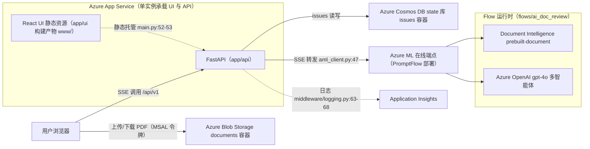
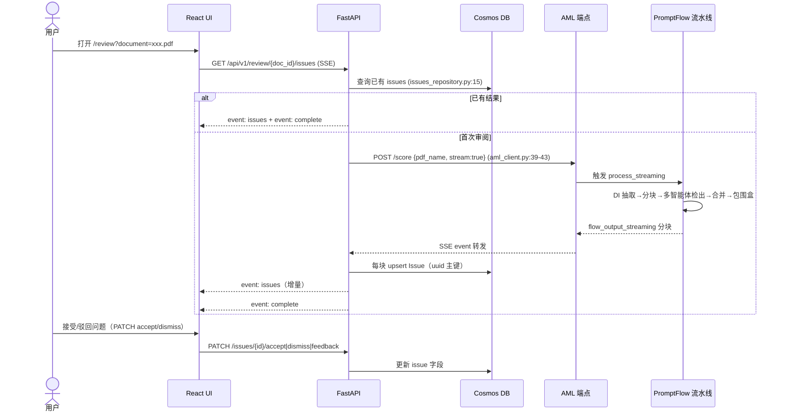

> **[2026-11] 时效说明**：本系列 wiki 记录的是 Azure 架构时期的实现细节，部分章节（Blob 直连、Cosmos、Entra/MSAL、PromptFlow、AML 端点）已不再适用。当前方案见 [README](../../README.md)、[local_deployment.md](../local_deployment.md) 与 [local-deployment-plan.md](../local-deployment-plan.md)。数据契约（Issue 模型与 SSE 事件）仍保持一致，其余请以最新文档为准。

# 01 · 架构

## 定位

AI Document Review 是面向「合规与准确性敏感文档」的 AI 审阅加速器：用户定义「审阅智能体」（以 guideline 提示词表达），系统对上传的 PDF 执行文本抽取、多智能体问题识别、结果流式展示与人工复核反馈闭环（`README.md:9-16`）。

## 运行时架构



要点：UI 与 API 同部署于 App Service，构建产物由 FastAPI 以静态文件托管（`app/api/main.py:52-53`，构建输出目录配置见 `app/ui/vite.config.ts:7-9`）。PDF 上传/下载由浏览器直连 Blob Storage（`app/ui/src/services/storage.ts`），不经 API 转发。

## 分层结构（API 侧）

按功能组织 + 三层：

```
routers/issues.py      ← 控制器：路由、SSE 组装、错误映射
services/issues_service.py ← 服务：审阅编排、状态流转、反馈
database/issues_repository.py ← 仓储：Issue 的 Cosmos CRUD
database/db_client.py  ← 通用 Cosmos 客户端（upsert/read/query）
services/aml_client.py ← 外部调用：AML 端点 SSE 消费
security/auth.py       ← Entra ID 单租户 Bearer 鉴权
dependencies.py        ← 组合根：手工构造服务对象
```

依赖方向为 控制器 → 服务 → 仓储/外部客户端，由 `dependencies.py:9-20` 手工注入（未使用容器，每次请求新建 `MLClient` 与凭据，见 [08-问题清单](08-issues-and-recommendations.md) P2-08）。

## 核心数据流（审阅一次文档）



（对应代码：`app/api/routers/issues.py:31-87`、`app/api/services/issues_service.py:39-75`、`flows/ai_doc_review/process_streaming.py:12-15`。与官方 `docs/architecture.md:51-84` 的时序一致，官方图另含评估数据存储。）

## 技术选型与理由

| 决策 | 选择 | 依据/备注 |
|---|---|---|
| API 框架 | FastAPI 0.112（`app/api/requirements.txt:1`） | 原生 SSE（StreamingResponse）、Pydantic 校验、async 路由 |
| 鉴权 | fastapi-azure-auth 单租户授权码 + PKCE（`app/api/security/auth.py:7-14`；Swagger 配置 `app/api/main.py:18-24`） | Entra ID 企业场景；前端 MSAL Redirect（`app/ui/src/authConfig.ts:21`） |
| 状态存储 | Cosmos DB（`app/api/config/config.py:12-16`） | 托管 NoSQL、托管身份连接（`app/api/database/config.py:14`） |
| 编排 | PromptFlow 1.17（`flows/requirements.txt`） | DAG 式多智能体、可部署为 AML 在线端点、自带指标打点 |
| 文档抽取 | Document Intelligence `prebuilt-document`（`flows/ai_doc_review/text.py:9`） | 段落/词级坐标，支撑高亮包围盒 |
| LLM | gpt-4o，typed_llm 工具强制 JSON 结构化输出（`flows/ai_doc_review/agent_template/flow.dag.yaml:48-79`） | 5-shot 检出 + 1-shot 整合，结构由 `common/models.py` 约束 |
| 前端 | React 18 + Fluent UI v9 + react-pdf + annotpdf（`app/ui/package.json:6-20`） | 需要浏览器端 PDF 高亮标注 |

## 关键 ADR 式决策

1. **共享模型单一来源**：`common/models.py` 同时被 API 与 Flow 引用——API 侧直接 import；Flow 侧通过 `additional_includes: ../../common`（`flows/ai_doc_review/flow.dag.yaml:9-10`）打包，部署时由 `.task/flow.yml:82` 复制 `common/`。这保证两侧 Issue 结构一致。
2. **Agent 模板 + 提示词覆盖**：单一 `agent_template` Flow 通过 `FlowContext.overrides` 按问题类型替换 agent/consolidator/guidelines 三个提示词文件（`flows/ai_doc_review/flows.py:29-44`），新增审阅类型只需新增一组 jinja2 提示词并在 `AGENT_PROMPTS` 注册（`flows.py:15-26`）。
3. **SSE 分块流式**：`process_streaming` 按分块 yield，端点以 `text/event-stream` 转发（`app/api/routers/issues.py:77`），每个分块即时入库，用户无需等全文完成。
4. **AML 端点而非 App Service 承载 Flow 的长流**：`docs/architecture.md:37` 提到 PromptFlow 端点受 180s 限制，本仓库实际通过 `az ml online-endpoint` 部署并将 `request_timeout_ms` 提至 300000（`flows/ai_doc_review/deployment.yaml:22-24`）。

## 架构风险

- **CORS 通配 + 凭据**（`app/api/main.py:28-34`）：`allow_origins=["*"]` 与 `allow_credentials=True` 组合会被 Starlette 回显任意 Origin，等效于任意站点可携带凭据调用 API，详见 [08-问题清单](08-issues-and-recommendations.md) P1-01。
- **全局异常回显 `str(exc)`**（`app/api/main.py:67-76`）：内部错误细节（含异常消息）直接返回客户端，见 P1-02。
- **同步 Cosmos SDK 在 async 路由内调用**（`app/api/database/db_client.py:18-78` 均为 `async def` 但内部是同步 SDK 调用）：阻塞事件循环，见 P1-03。
- **无幂等/并发控制**：同一文档并发两次打开 review 页会触发两次 AML 调用并重复入库（uuid 主键不冲突），见 P1-06。
- Terraform 使用 `2023-08-01-preview` 的 NSP API（`infra/resources.tf:14`），预览版 API 存在变更风险（未验证当前兼容性）。
