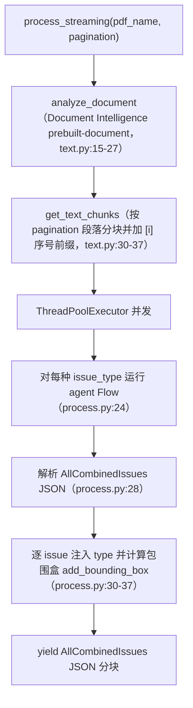
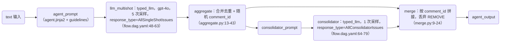

# 03 · 审阅流水线（核心模块）

> 该模块替代常规 Wiki 中的"采集器"章节：`flows/ai_doc_review/` 是本项目核心 AI 流水线，由 PromptFlow 编排，部署为 Azure ML 在线端点（`flows/ai_doc_review/deployment.yaml`），API 通过 SSE 调用它。

## 入口与 DAG

顶层 Flow（`flows/ai_doc_review/flow.dag.yaml`）：

- 输入：`pdf_name`（默认 sample.pdf）、`stream`（默认 true）、`pagination`（默认 32，:11-23）。
- 条件激活：`stream=true` 走 `process_streaming` 节点，否则走 `process` 节点（:40-53）。
- 输出：`flow_output_streaming`（流式 JSON 串）与 `flow_output`（全量 JSON 串）（:24-30）。
- 部署时 `PROMPTFLOW_RESPONSE_INCLUDED_FIELDS='["flow_output_streaming"]'` 只暴露流式输出（`deployment.yaml:33`）。

非流式 `process`（`flows/ai_doc_review/process.py:42-49`）硬编码 `pagination=64`，与 DAG 默认 32、`text.py:10` 的 16 三处不一致（P2-12）。

## 端到端流程

关键细节（观察行为）：

- 文本块每段加 `[i]` 索引前缀，提示词明确要求模型忽略前缀、在 `para_index` 里回传索引号（`flows/ai_doc_review/prompts/grammar/agent.jinja2:26-35`）。
- `pagination=-1` 时全文档合成一个块（`text.py:31-32`）。

## Agent 子流（agent_template）

`flows/ai_doc_review/agent_template/flow.dag.yaml` 定义了可被任意问题类型复用的模板：

- `llm_multishot` `number_of_requests=5`、`temperature=1`（:58-61）：同一文本采样 5 次，`aggregate` 以 `(type, source_sentence)` 为键去重（`agent_template/aggregate.py:24-29`），再赋 6 位随机 `comment_id`（:7-9, :36-37，用 `random` 而非 `secrets`，碰撞概率低但存在）。
- `consolidator` 对聚合结果打分并给出 `suggested_action`；`merge` 按 `comment_id` 匹配拼接两路字段，`suggested_action == "REMOVE"` 的低分问题被丢弃（`agent_template/merge.py:17-24`）。
- 模板中的 jinja2 是占位内容（`agent_template/agent.jinja2:1` 为 "INSERT YOUR PROMPT BELOW"），运行时被 `flows.py:29-44` 的 `FlowContext.overrides` 替换为 `prompts/{grammar|definitive_language}/` 下的真实提示词，连接通过 `AzureOpenAIConnection(auth_mode="meid_token")` 走 Entra（`flows.py:48-52`）。

## 提示词体系

| 文件 | 角色 |
|---|---|
| `prompts/grammar/agent.jinja2` | 语法拼写审阅者：英式英语、逐句审查、输出 JSON 字段规范（type/text/explanation/suggested_fix/location.source_sentence/para_index） |
| `prompts/grammar/guidelines.jinja2` | 69 行分级准则：Grammar/Spelling 高优先级[7-10]、句式结构/一致性中[4-7]、标点低[0-4]、正式语气与抽取伪影不修正 |
| `prompts/grammar/consolidator.jinja2` | 整合者：5 步流程，校验 suggested_fix 是否真正改进原文 |
| `prompts/definitive_language/*` | 「确定性表述」（保证性语句）审阅者，同一模板 |

`agent_template/guidelines.jinja2:1` 是占位符（"INSERT YOUR GUIDELINES HERE"），同样被覆盖。

## 包围盒计算（bounding_box.py）

`add_bounding_box`（`flows/ai_doc_review/bounding_box.py:50-100`）流程：

1. 由 `para_index` 取 DI 段落 → 页码 + 段落 span offset（:61-62）。
2. 在 `source_sentence` 中定位 `issue.text` 子串索引（:69-73，找不到则仅记日志并返回无包围盒的 issue）。
3. 在页面词表中找段落首词（按 span.offset 匹配，:77-81，失败同样降级返回）。
4. 用「段落起始词序 + issue 前词数」推算 issue 词序列（:84-91）——**按空格 split 计数**，对连字/多空格/跨行文本脆弱。
5. `create_bounding_box`（:8-47）：shapely 合并词多边形 → 72 DPI 缩放为像素 → y 轴翻转为 PDF 底部原点 → 转 quadpoints（每行一个 8 元组）。

任何一步失败都会产出**无/不完整 bounding_box 的 issue**，而 `Location.bounding_box: list[float]` 为必填（`common/models.py:9`），前端按 `bounding_box[1]` 排序（`app/ui/src/pages/review/Review.tsx:312`），空数组会导致前端崩溃（P1-07）。

## 数据结构契约

- 智能体原始输出：`AllSingleShotIssues` → 合并后 `AllCombinedIssues`（`common/models.py:38-47`）。
- 端点侧消费：`FlowOutputChunk{issues: list[BaseIssue]}`（`common/models.py:58-59`）——`BaseIssue` 不含 comment_id/score，即整合者元数据在 API 侧被丢弃。
- 评估流（`flows/ai_doc_review_eval/flow.dag.yaml`）：`evaluation` 节点调 `eval/src/issue_associator.py` + `metric_calculator.py`，`aggregate`/`log_metrics` 两个聚合节点经 `MetricsCalculator.calculate_metrics_from_multiple_results` 聚合后 `promptflow.log_metric` 打点（`flows/ai_doc_review_eval/aggregate.py:7-16`、`log_metrics.py:7-14`）。

## 脆弱性清单

| 位置 | 问题 |
|---|---|
| `process.py:45` | 非流式路径 pagination=64 硬编码，与流式配置脱节 |
| `agent_template/merge.py:20` | `dict(left_issue, **dict(right_issue))` 依赖 pydantic 模型的 dict 化行为，隐式易碎 |
| `bounding_box.py:84` | 空格分词推词序，标点/排版差异即错位 |
| `text.py:21` | `pdf_url` 直接拼接 `STORAGE_URL_PREFIX/{pdf_name}`，文件名含特殊字符未转义 |
| `flows.py:9` | `AZURE_OPENAI_ENDPOINT` 为空时连接仍被创建，失败延迟到运行期 |
| `process.py:33-37` | 包围盒失败仅记日志继续，产生降级数据下游无显式标记 |
