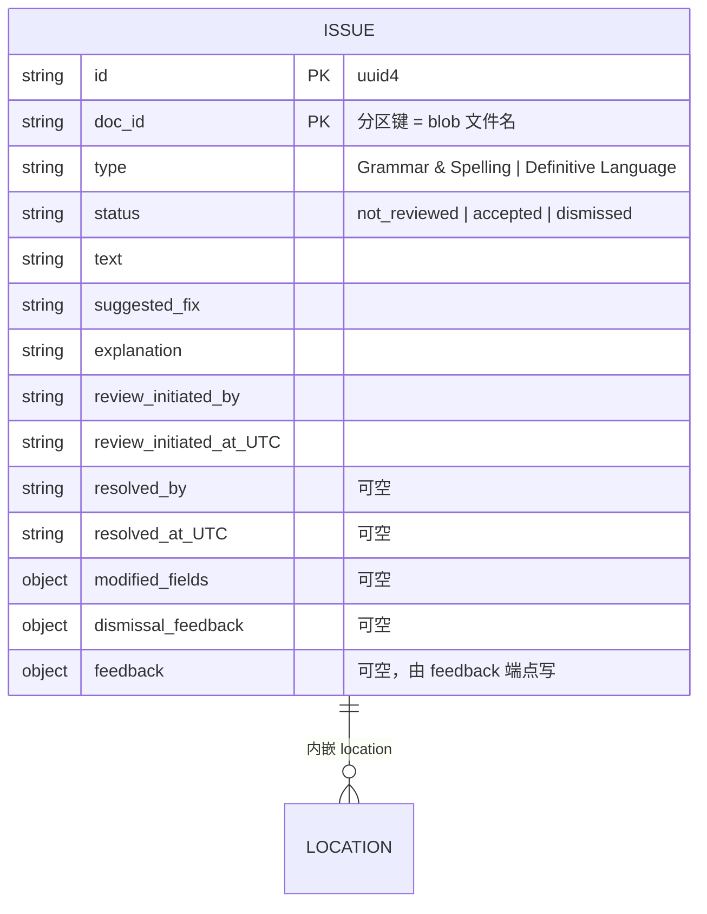
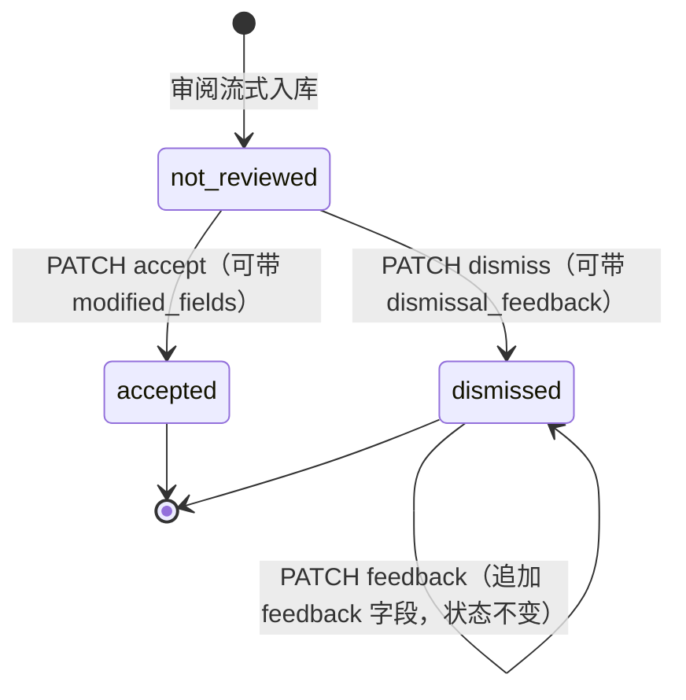

# 04 · 数据模型

> 存储为 Azure Cosmos DB（NoSQL，无 DDL/schema 迁移）。本环境无法连接真实数据库，**实际容器数据快照、分区键策略与 RU 消耗：未验证**；以下结构均来自代码证据。

## 容器与分区

| 项 | 值 | 证据 |
|---|---|---|
| 数据库 | `state` | `app/api/config/config.py:14` |
| issues 容器 | `issues` | `config.py:15`；`issues_repository.py:12` |
| feedback 容器 | `feedback` | `config.py:16`；**代码中未使用**（反馈实际写入 issue 文档内） |
| 分区键 | `doc_id` | `issues_repository.py:39`（`retrieve_item_by_id(issue_id, doc_id)`）+ `db_client.py:40` |
| 写入方式 | 全量 upsert（读-改-写或整对象 upsert） | `db_client.py:25`、`issues_repository.py:43-53` |
| 连接 | `CosmosClient(cosmos_url, DefaultAzureCredential())`（托管身份；`cosmos_key` 配置项未使用） | `database/config.py:14` |

## Issue 文档结构

单一文档类型 `Issue`（`common/models.py:77-94`，Pydantic `use_enum_values=True`，落库为字符串枚举值）：

| 字段 | 类型 | 必填 | 说明 | 写入时机 |
|---|---|---|---|---|
| `id` | str | ✔ | uuid4 字符串，文档主键 | 审阅入库时（`issues_service.py:61`） |
| `doc_id` | str | ✔ | PDF 文件名（blob 名），分区键 | 同上（`issues_service.py:62`） |
| `text` | str | ✔ | 问题原文片段 | 智能体输出 |
| `type` | str 枚举 | ✔ | `Grammar & Spelling` / `Definitive Language` | 流水线注入（`process.py:32`） |
| `status` | str 枚举 | ✔ | `not_reviewed` / `accepted` / `dismissed` | 初始 not_reviewed（`issues_service.py:63`），PATCH 时变更 |
| `suggested_fix` | str | ✔ | 建议修改 | 智能体输出 |
| `explanation` | str | ✔ | 问题解释 | 智能体输出 |
| `location` | Location? | 可空 | 见下表 | 智能体输出 + 包围盒补全 |
| `review_initiated_by` | str | ✔ | 发起者 Entra oid | 入库时（`issues_service.py:64`） |
| `review_initiated_at_UTC` | str | ✔ | ISO 时间字符串 | 路由传入（`issues.py:62-63`） |
| `resolved_by` | str? | — | 处理人 oid | accept/dismiss（`issues_service.py:94,133`） |
| `resolved_at_UTC` | str? | — | 处理时间 | 同上 |
| `modified_fields` | ModifiedFieldsModel? | — | `{suggested_fix?, explanation?}` 用户改写 | accept（`issues_service.py:98-99`） |
| `dismissal_feedback` | DismissalFeedbackModel? | — | `{reason?}` 驳回时即时反馈 | dismiss（`issues_service.py:137-138`） |
| `feedback` | dict | — | 驳回后补充反馈 `{reason?}` | feedback 端点（`issues_service.py:169-173`） |

> 注意：`feedback` 与 `dismissal_feedback` 是两个独立字段；`DismissalFeedbackModel` 无 `feedback` 字段（`common/models.py:73-74`），`add_feedback` 直接写 dict。

### Location 子结构（`common/models.py:6-10`）

| 字段 | 类型 | 说明 |
|---|---|---|
| `source_sentence` | str | 含问题的完整原句 |
| `page_num` | int | 由 `add_bounding_box` 补全（`bounding_box.py:66`） |
| `bounding_box` | list[float] | quadpoints（8×n），由 `create_bounding_box` 计算；失败时可能为空数组 |
| `para_index` | int | 文档段落索引（提示词要求模型回传，`prompts/grammar/agent.jinja2:35`） |

## 中间数据结构（不入库，流式传输用）

| 模型 | 用途 |
|---|---|
| `SingleShotIssue` / `AllSingleShotIssues`（:18-39） | agent 5-shot 原始输出（含 comment_id） |
| `ConsolidatorIssue` / `AllConsolidatorIssues`（:27-44） | 整合者评分输出（score、suggested_action） |
| `CombinedIssue`（:34-35） | 两者字段合并 |
| `FlowOutputChunk`（:58-59） | AML 端点每块输出（仅 `issues: list[BaseIssue]`，comment_id/score 丢弃） |

## ER / 生命周期

## 去重 / 迁移 / 生命周期

- **去重**：文档内去重仅发生在流水线侧（`agent_template/aggregate.py:24-29`）。同一文档重复发起审阅会生成全新 uuid 集，旧记录不清理 → 数据翻倍（P1-06）。
- **迁移**：无版本化迁移机制；模型变更即隐式变更落库格式（`Issue(**issue)` 对未知/缺失字段敏感）。
- **删除**：代码未实现任何删除路径；issue 永久留存于 `issues` 容器。
- **TTL**：未设置。

## 数据质量风险（静态证据）

1. `Issue.location` 允许 None，但前端按 `issue.location.page_num`、`bounding_box[1]` 直接访问（`app/ui/src/types/issue.ts:9-13` 声明为必填、`Review.tsx:312-314` 排序）——空包围盒/缺 location 的文档会使 review 页崩溃（P1-07）。
2. `get_issue` 对 404 返回 None 后 `Issue(**None)` 抛 TypeError（`issues_repository.py:39-40` + `db_client.py:43-45`）→ 该端点 500 而非 404（P2-04）。
3. `retrieve_items_by_values` 出错返回 None，`get_issues` 随即 `len(None)` 抛 TypeError（`issues_repository.py:26-27`）（P2-05）。
4. `system_monitor.py:83-84` 期望 `doc_major_version`/`doc_minor_version` 列，但 `Issue` 模型并无这两个字段（`common/models.py:77-94`）——该分析代码与当前 schema 脱节，运行必 KeyError（P1-09，运行时未验证）。
