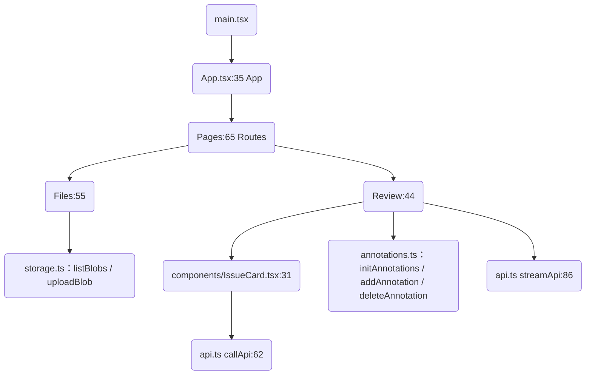
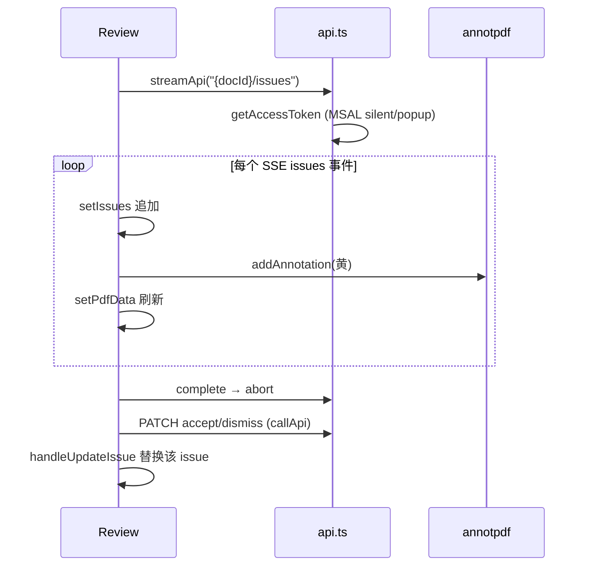

# 05 · 前端

> 位置 `app/ui/`。React 18 SPA，构建产物输出到 `app/api/www` 由 FastAPI 托管（`vite.config.ts:7-9`）；本地开发经 Vite 代理 `/api → http://localhost:8000`（`vite.config.ts:10-14`）。`npm run build` 在文档生成环境未安装依赖，**未验证**。

## 技术栈（`package.json:6-20`）

- UI：`@fluentui/react-components` v9 + `@fluentui/react-icons`
- 鉴权：`@azure/msal-browser` + `@azure/msal-react`（Redirect 流）
- 存储：`@azure/storage-blob`（浏览器直连 Blob）
- PDF：`react-pdf` v9（pdf.js worker 经 `new URL(...)` 注入，`pages/review/Review.tsx:17-20`）+ `annotpdf`（高亮标注）
- SSE：`@microsoft/fetch-event-source`
- 路由：`react-router-dom` v7；构建：Vite 6 + TS 5.6

## 环境变量（`import.meta.env`，构建期注入）

| 变量 | 用途 | 证据 |
|---|---|---|
| `VITE_CLIENT_ID` / `VITE_TENANT_ID` | MSAL 单租户配置 | `authConfig.ts:5-6` |
| `VITE_API_SCOPE` | API user_impersonation scope | `authConfig.ts:23-25` |
| `VITE_STORAGE_ACCOUNT` / `VITE_STORAGE_DOCUMENT_CONTAINER` | Blob 直连 | `main.tsx:27-29` |

## 启动与鉴权流

`main.tsx`：初始化 MSAL → 设定活动账户（:31-43）→ 渲染 `Router > FluentProvider > App`。

`App.tsx`：`MsalProvider` + `MsalAuthenticationTemplate`（Redirect 登录，未登录自动跳转）→ 顶栏（返回按钮 + Avatar，无用户名绑定，:53）→ `Routes`（:65-72）：

| 路由 | 页面 |
|---|---|
| `/` | `pages/files/Files.tsx` — 文档列表与上传 |
| `/review?document=<blob名>` | `pages/review/Review.tsx` — 审阅工作台 |

令牌获取（`services/api.ts:12-31`）：静默获取 → 失败且为 `InteractionRequiredAuthError` 时弹窗重取；**其他错误返回 undefined**，后续 `Bearer undefined`（P2-10）。

## 组件树

## Files 页（文档列表）

- 挂载时 `listBlobs()` 列出 `documents` 容器；错误显示 MessageBar（`Files.tsx:63-74`）。
- 点击「Upload new document」触发隐藏 `<input type=file accept="application/pdf">`（:128-143）→ `uploadBlob` 上传后直接 `navigate('/review?document=...')`（:84-99, :101-102）。
- 上传中显示不可关闭 Dialog（:189-198）。无重复文件名检查（同名即覆盖 blob）。

## Review 页（审阅工作台）

状态与副作用：

1. URL 解析 `document` 参数（`Review.tsx:219-226`）。
2. 下载 PDF → `initAnnotations` 初始化标注层 → 存入 `pdfData`（:229-249）。
3. `docId` 变化即自动 `runCheck()`（:252-261），卸载时 abort。

`runCheck`（:163-216）— SSE 事件处理：

- `issues`：解析 `Issue[]` 追加状态；对每个带包围盒的问题调 `addAnnotation`（黄色半透明）并整体刷新 PDF 字节（:175-193）。
- `error`：throw → fatalErrorHandler 显示（:195-197）。
- `complete`：abort 连接，置完成态（:198-203）。

问题列表（:306-333）：状态过滤（TagPicker）+ 类型显隐过滤 → **先按 `bounding_box[1]` 降序、再按页码升序排序**（:312-314）→ 渲染 `IssueCard`。

Issue 选中（:97-128）：翻页到问题页；红色高亮标注；再次点击取消并删除标注。

IssueCard（`components/IssueCard.tsx`）：

- `handleAccept`（:58-90）：收集修改后的 explanation/suggested_fix → PATCH accept → 用响应替换列表中该 issue。
- `handleDismiss`（:95-113）：PATCH dismiss → 显示「Help us improve」反馈卡。
- `handleSubmitFeedback`（:118-133）：PATCH feedback。
- 错误均映射为 MessageBar 文案（来自 `api.ts:33-60` 的 `getErrorMessage`，解析 `detail`/`message`）。

agentConfig 目前为硬编码两类型（`Review.tsx:54-63`，注释 `TODO: get from DB`）。

## PDF 高亮标注（`services/annotations.ts`）

- 模块级单例 `annotator`（:4）；`initAnnotations` 写入一个 dummy 标注以初始化标注层（:10-16）。
- `addAnnotation(page_num, quad)`：页码 -1 转 0 基（:29）；quadpoints 为 PDF 底部原点坐标——与后端 `create_bounding_box` 的坐标约定（`bounding_box.py:36-38`）对齐。
- **无空值保护**：初始化前调用 `addAnnotation` 会抛错（调用顺序当前安全，但脆弱，P2-11）。

## 状态流小结

## 已知 UI 问题（证据见 08 章）

- 排序直接访问 `location.bounding_box[1]`，空包围盒即 TypeError（`Review.tsx:312`）。
- `handleUpdateIssue` 直接改传入数组元素再浅拷贝（:131-139），依赖 `setIssues` 触发渲染，属 React 反模式。
- `api.ts` 重试路径 `startStream()` 递归调用无退避、不 await，可能并发多路流（:125-135）。
- MSAL 缓存 `cacheLocation: 'localStorage'`（`authConfig.ts:10-13`）——令牌缓存落 localStorage，XSS 风险面较大（P2-13）。
