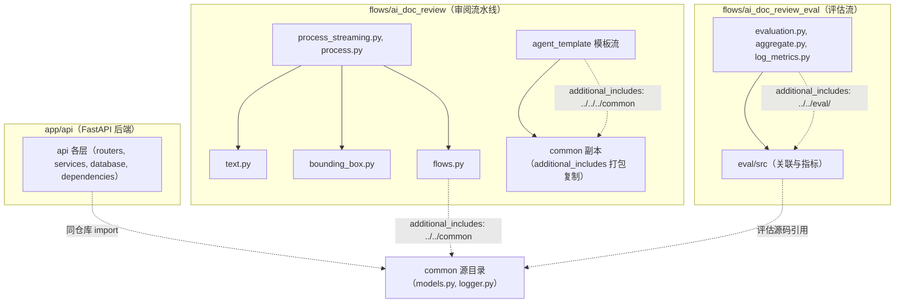

> **[2026-11] 时效说明**：本系列 wiki 记录的是 Azure 架构时期的实现细节，部分章节（Blob 直连、Cosmos、Entra/MSAL、PromptFlow、AML 端点）已不再适用。当前方案见 [README](../../README.md)、[local_deployment.md](../local_deployment.md) 与 [local-deployment-plan.md](../local-deployment-plan.md)。数据契约（Issue 模型与 SSE 事件）仍保持一致，其余请以最新文档为准。

# 06 · 依赖

> 三套相互独立的依赖清单；`common/` 是被两侧共享的源码级依赖（非包）。

## 运行时依赖（API，`app/api/requirements.txt`，均精确锁定）

| 包 | 版本 | 使用位置 |
|---|---|---|
| fastapi[standard] | 0.112.0 | `app/api/main.py`、路由层 |
| uvicorn[standard] | 0.32.0 | 本地启动 `.task/app.yml:120` |
| pydantic / pydantic-settings | 2.8.2 / 2.4.0 | `common/models.py`、`config/config.py` |
| fastapi-azure-auth | 5.0.0 | `security/auth.py:2-3` |
| azure-identity | 1.17.1 | `dependencies.py:4`、`database/config.py:2`、`aml_client` 间接 |
| azure-cosmos | 4.7.0 | `database/db_client.py`、`database/config.py` |
| azure-ai-ml | 1.19.0 | `dependencies.py:5` |
| sseclient-py | 1.8.0 | `services/aml_client.py:8` |
| requests | (transitive) | `services/aml_client.py:5`（未显式声明，靠 fastapi/azure 传递） |
| opencensus-ext-azure / -fastapi | 1.1.13 / 0.1.0 | `middleware/logging.py:5`（仅 azure log exporter；-fastapi 已安装未见 import） |
| marshmallow | 3.19.0 | **代码中无使用点**（疑似残留） |

## 运行时依赖（Flow，`flows/ai_doc_review/requirements.txt`）

| 包 | 版本 | 使用位置 |
|---|---|---|
| promptflow / [azure] / tools | 1.17.1 / 1.17.1 / 1.4.0 | Flow 编译、加载、typed_llm 包工具 |
| promptflow_typed_llm | 0.0.8 | `agent_template/flow.dag.yaml:52,68` 的 `typed_llm.tools.typed_llm.typed_llm` |
| azure-ai-formrecognizer | 3.3.3 | `text.py:6`（Document Intelligence SDK） |
| shapely | 2.0.6 | `bounding_box.py:2` |
| pymupdf (fitz) | 1.24.11 | `bounding_box.py:3`（仅用 `Rect.quad`） |
| openai | 1.43.0 | typed_llm 底层 |
| httpx | 0.27.2 | 未在源码直接使用（可能供 promptflow/openai） |
| asttokens / json5 | — | 未在源码直接使用，疑似传递/残留 |

`flows/requirements.txt`（仅 promptflow 三件套）供 `flows/ai_doc_review_eval/` 与部署环境复用。

## 运行时依赖（前端，`app/ui/package.json`）

| 包 | 版本 | 使用位置 |
|---|---|---|
| react / react-dom | ^18.3.1 | 全部页面 |
| react-router-dom | ^7.0.2 | `App.tsx:5`、`main.tsx:5` |
| @azure/msal-browser / msal-react | ^3.28.0 / ^2.2.0 | `main.tsx`、`authConfig.ts`、`App.tsx` |
| @azure/storage-blob | ^12.26.0 | `main.tsx:2`、`services/storage.ts` |
| @azure/identity / @azure/core-auth | ^4.5.0 / ^1.9.0 | **未见 import**（Blob 凭据用自实现 MSAL 适配器，`main.tsx:10-23`），疑似残留 |
| @fluentui/react-components / icons | ^9.56.3 / ^2.0.266 | 全部 UI |
| @microsoft/fetch-event-source | ^2.0.1 | `services/api.ts:2` |
| annotpdf | ^1.0.15 | `services/annotations.ts` |
| react-pdf | ^9.1.1 | `pages/review/Review.tsx:4` |

开发依赖：Vite 6、TS 5.6、ESLint 9（flat config `eslint.config.js`）、`@vitejs/plugin-react` 等。

## 共享代码与模块依赖图

> 说明：API 各层（routers → services → database，dependencies 注入）的内部依赖见 [02-后端 API](02-backend-api.md)；本图聚焦 `common/` 的三种共享方式。

共享/复制机制（import 边界规则为"约定式"，无 lint-imports 强制）：

- Flow 侧：`flow.dag.yaml:9-10` `additional_includes: - ../../common`；`agent_template/flow.dag.yaml:5-6` 引 `../../../common`。构建/部署时实际复制目录（`.task/flow.yml:82`、`deployment.yaml` 打包）。
- API 侧：直接同仓库 import（运行目录为 `app/api`，`common` 需在其 sys.path 上；`.task/app.yml:92-93` 部署时把 `../common` 拷进 `api/common`——即生产包内 common 位于 `app/api` 之下）。
- 评估流：`flows/ai_doc_review_eval/flow.dag.yaml:5-6` `additional_includes: - ../../eval/`，`evaluation.py:2-3` 以 `eval.src.*` 导入。

注意命名冲突隐患：生产包内存在 `app/api/common`（部署复制），而源码中 `flows/ai_doc_review/flow.dag.yaml` 编译时也引用同名 `common`——`process.py:9` `from common.models import ...` 两侧解析到的物理路径不同但内容同源（单一代码来源，行为一致；属结构脆弱点）。

## 度量到的契约违规

- 无 import-linter / 架构 lint 配置（未发现 `lint-imports`、`import-linter` 等）；`npm run build`/`tsc` 未在本环境执行（**未验证**）。
- Python 语法层面：`python -m compileall app common flows eval` 全部通过（文档生成环境实测，exit 0）。
- pytest：`eval/tests` 已实测（2026-11-13，Python 3.13 + promptflow 1.18.5），3 通过 / 6 失败，详见 [08-问题清单](08-issues-and-recommendations.md)。注意锁定的 `promptflow==1.17.1` 不支持 Python 3.13（`Requires-Python !=3.13.*`）。
